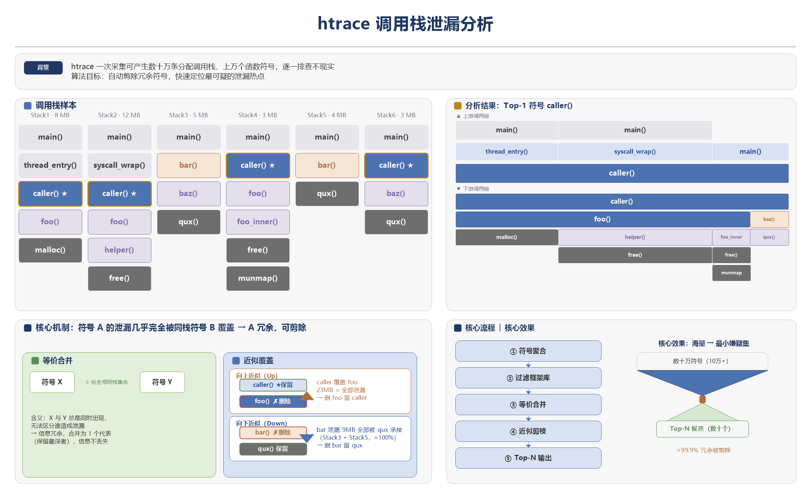

# mem-analyzer

内存分析命令行工具，基于 C++17 实现，用于分析 HarmonyOS 系统的各类内存泄漏。

> **如果你是二进制使用者**，可前往[mem-analyzer releases](https://gitcode.com/openharmony/developtools_profiler/tree/master/tools/mem_analyzer/releases)下载工具，使用说明请阅读 [docs/usage.md](docs/usage.md) — 完整命令行参考、所有子命令的选项说明、使用示例和常见场景。

---

## 功能概览

### 资源泄露日志采集（Profiler）

通过 `hdc` 连接 HarmonyOS 设备，实时采集目标进程的内存数据并可一键分析：

- 十种采集类型（`-c/--category` 指定）：nativeheap(NativeHeap堆) / snapshot(ArkTS堆快照) / globalhandle(ArkTS全局句柄) / allhandle(ArkTS全局&局部句柄) / localhandle(ArkTS局部句柄) / nativeleaks(Native堆分配 + 不可达内存泄漏快照) / fd(文件描述符) / dma(DMA/ion内存) / thread(线程) / ashmem(匿名共享内存)
- 环境自检：hdc 可用性、设备连接、API 版本（ArkTS堆快照采集（`snapshot`）要求 ≥ 24，其余要求 ≥ 26）
- 设备目标：`--device <serial number>` 指定目标设备（取值为设备序列号，见 `hdc list targets`）；仅连接 1 台时可省略（工具会自动使用该设备），≥2 台设备时必须指定；`hdc list targets` 输出无法唯一确定目标时（含无法识别的行）工具会报错并要求显式指定，不会自行挑一台设备
- 设备级输出隔离：用 `--device` 显式指定目标设备时，采集产物落在 `<输出目录>/<device-id>/<会话目录>/` 下，多台设备的报告不会混在一起；仅连接 1 台设备而未传 `--device` 时工具会自动使用该设备，此时**不加设备层**，产物直接落在 `<输出目录>/<会话目录>/`（`-d` 目录或默认 `out` 保持原样）。只要有设备驱动本次运行（显式 `--device`，或仅连接 1 台时自动选定），输出首行都会打印 `Device: <device-id>`
- 进程名解析：支持包名或应用名匹配、`--list-apps` 列举
- 自动化：应用自动拉起、随时停止采集（`Ctrl+C`；采集期间设备掉线会提前结束并保存已采集数据）
- 起止 smaps / fd 日志导出，便于前后对比
- `-o` 采集后自动调用对应分析子命令生成 HTML 并打开浏览器

### 堆快照日志分析（Jsleak）

处理 heapsnapshot 文件，分析 ArkTS 对象泄漏：

- 属性标签检测（`isDeleting_` / `_isDisposed` / `isDestroyed`）
- BFS 最短引用链分析
- Lengauer-Tarjan 支配树 retained size 计算

### 堆快照对比（Snapshot Compare）

对比两份 `.heapsnapshot` 或 `.rawheap` 快照：

- 分析发生变化的 ArkUI 组件和 ArkTS 泄漏对象
- 展示增长、缩减对象的最短引用链
- 生成 HTML 报告

### ArkTS Handle日志分析（Tshandle）

处理 tshandle ZIP 文件，分析 ARK Handle 事件关联的类实例泄漏：

- ArkTS 堆快照 流式解析（16MB 分块）
- Lengauer-Tarjan 支配树（retained size）
- 地址关联（ARK Handle 地址 → heapsnapshot nodeId）

### Htrace日志分析（Trace）

解析 htrace 文件，提取调用栈数据，识别内存泄漏热点：

- 统计模式/详情模式自动检测
- 多资源类型：nativeheap / mmap-anon / dma / ashmem / fd / thread
- Native符号离线反解：`--so-dir` 指定 `.so` 符号表目录
- 范围过滤：app-only / system-only / app-and-system / mixed
- 等价符号检测 + up/down approximation 过滤
- 泄漏地址过滤（`-l`）：按 Native Leaks 不可达内存泄漏文件过滤；`-p` 仅按地址匹配过滤输出 callStacks，分析模式（不带 `-p`）额外排除 `__emutls_get_address` 路径、按沙箱目录 `data/storage/el`+arkweb 例外分应用/系统栈，top N 之外的栈合并为 other 火焰图
- 上游/下游调用链可视化
- JSON + HTML 双格式输出

算法核心思想示意：



---

## 快速开始

### 构建

```bash
# Windows（在 cpp/ 目录下运行）
.\build-win.ps1

# macOS（自动检测 arm64/x86_64）
chmod +x build-mac.sh && ./build-mac.sh

# Linux 跨平台编译（原生 + MinGW Windows）
chmod +x release-cross.sh && ./release-cross.sh
```

构建脚本会自动初始化第三方依赖（nlohmann/json、SQLite3、trace_streamer 等）。

### 运行

```bash

# 从连接的设备实时采集 NativeHeap 堆分配，并自动生成报告
mem-analyzer profiler -t 60 -o com.example.app 

# 多台设备同时连接时，用 --device 指定目标设备序列号（取值见 hdc list targets，请勿手动加引号；仅连接 1 台时可省略）
mem-analyzer profiler -t 60 -o --device 33Z0224A22021343 com.example.app

# 自动检测文件类型，并进行分析
mem-analyzer profile.htrace

# 分析 NativeHeap 堆
mem-analyzer trace -c nativeheap -f html profile.htrace

# 仅解析，输出 JSON
mem-analyzer trace -p -f json profile.htrace

# 按 Native Leaks 不可达内存泄漏文件过滤；-p 走解析输出 callStacks，不带 -p 走分析输出 topSymbols（含 other）
mem-analyzer trace -l leaks.bin -f json profile.htrace

# 处理 tshandle ZIP 包
mem-analyzer tshandle -f html handle_data.zip

# 堆快照泄漏分析
mem-analyzer jsleak heap.heapsnapshot

# Debug模式：显示调试日志并保留中间产物目录
mem-analyzer --debug trace -c nativeheap profile.htrace

# 对比两份堆快照
mem-analyzer jsleak -b baseline.heapsnapshot target.heapsnapshot

```

> 完整命令行参考见 [docs/usage.md](docs/usage.md)

---

## 目录结构

```
mem-analyzer/
├── README.md
├── docs/                         # 设计/优化文档 + 使用者手册
│   └── usage.md
├── build/                        # 构建辅助脚本
│   ├── gen_notice.py
│   ├── setup_deps.py
│   └── compare_commits.py        # 跨 commit 对比工具
├── cpp/                          # C++ 分析引擎
│   ├── CMakeLists.txt
│   ├── build-win.ps1 / build-mac.sh / release-cross.sh
│   ├── config/                   # 运行期配置
│   │   ├── htrace/               #   分类规则 / 过滤规则 / 算法阈值
│   │   ├── jsleak/
│   │   └── profiler/             #   采集配置与设备命令模板
│   ├── include/                  # 头文件（L0 → L4 单向依赖）
│   │   ├── cli/                  #   L0 命令层
│   │   ├── profiler/             #   L1 采集层
│   │   ├── htrace/               #   L2 数据域：htrace 原生内存
│   │   ├── tshandle/             #   L2 数据域：句柄泄漏（zip）
│   │   ├── jsleak/               #   L2 数据域：快照泄漏
│   │   ├── shared/               #   L3 被 ≥2 个域复用的模型与算法
│   │   ├── formatter/            #   L4 输出公共件（html/ + json/）
│   │   ├── config_mgr/           #   L4 运行时配置 / 分类 / 过滤
│   │   ├── utils/                #   L4 基建
│   │   └── core/                 #   跨层契约：模块接口 / 能力表 / 格式路由 / RunContext
│   └── src/                      # 源文件（与 include/ 对应）
└── third_party/
    ├── bin/                      # 二进制依赖（trace_streamer / rawheap_translator）
    └── src/                      # 第三方源码
        ├── third_party_json/     # nlohmann/json（header-only）
        └── third_party_sqlite/   # SQLite3（amalgamation）
```

> 分层与依赖方向、目录收纳条件见 [AGENT.md](AGENT.md)；引擎内部结构与数据结构见 [cpp/README.md](cpp/README.md)。

---

## 构建详情

### 构建系统

- **构建工具**: CMake >= 3.16
- **C++ 标准**: C++17

> 强烈建议使用如下脚本来编译，改脚本会自动编译打包，手动直接执行cmake编译会有依赖缺失，导致运行失败。

### 构建脚本

| 脚本 | 平台 | 说明 |
|------|------|------|
| `build-win.ps1` | Windows | MinGW 静态链接构建，打包为 ZIP |
| `build-mac.sh` | macOS | 原生构建，自动检测 arm64/x86_64 |
| `release-cross.sh` | Linux | 跨平台交叉编译（Linux + MinGW Windows） |

### macOS 构建注意事项

`third_party/bin/trace_streamer_binary/` 下的二进制通过 Git LFS 管理，macOS 需手动安装 git-lfs：

```bash
brew install git-lfs
git lfs install
git lfs pull
```

### Linux 交叉编译

```bash
# 安装基础依赖
sudo apt install cmake g++ clang llvm-dev xz-utils patch unzip curl make
sudo apt install g++-mingw-w64-x86-64 mingw-w64-tools
# MinGW 交叉编译需要 posix 线程模型（<thread>, <mutex> 依赖）：
sudo apt install g++-mingw-w64-x86-64-posix
# 或设置默认编译器为 posix 变体：
# sudo update-alternatives --set x86_64-w64-mingw32-g++ /usr/bin/x86_64-w64-mingw32-g++-posix

# 运行交叉编译
cd cpp && ./release-cross.sh
```

### 运行时依赖

编译产物为静态链接二进制，运行时仅依赖系统库：

- Windows：`KERNEL32.dll` + UCRT（Windows 10+ 自带）
- macOS / Linux：系统 libc

此外需外部工具（位于 `third_party/bin/`）：

| 工具 | 用途 |
|------|------|
| `trace_streamer` | htrace 格式 → SQLite DB 转换 |
| `rawheap_translator` | rawheap → heapsnapshot 格式转换 |

---

## 流水线架构

**一个数据域 = 一个模块**，模块自持整条管道，内部全为编译期类型（无 `ProcessData`、无 `std::any`、无字符串握手）：

```
输入文件 → 按扩展名选模块 → [parse] → 域内强类型结构 → [analyze] → 域内结果 → [render] → 输出文件
```

1. **Parse** — 模块自己解析：htrace 调用 `trace_streamer` 转 SQLite DB；zip 解压后提取 htrace + rawheap；heapsnapshot 流式解析 V8 快照
2. **Analyze** — htrace：等价符号检测 / up-down approximation / 火焰图冰柱图；tshandle：dominator tree / retained size / nativeRef 关联；snapshot：属性标签 / 最短引用链
3. **Render** — 按格式关键词调用域内 writer 自由函数直接写文件：JSON 为 `{ meta, content }`，HTML 为自包含交互式报告

管道层 `process_file` 只做三件事：按扩展名选模块 → 派生 `RunContext` → 调 `module.run()`；它不认识任何具体数据域。

---

## 核心模块

### 日志采集

#### 采集器（Profiler）

`profiler` 子命令通过 `hdc` 从设备实时采集内存数据：

| 模块 | 功能 |
|------|------|
| `profiler/` | 采集类型解析（`-c/--category`，支持 nh/native、snap、global/gh、handle/ah、local/lh 等别名）、设备目标指定（`--device`，取值为设备序列号；单设备可省略，工具会自动锁定该设备；≥2 台设备必填）、环境自检（hdc/设备/API 版本）、进程名解析（`bm dump -a -l`，支持包名/应用名匹配）、设备命令模板处理（`$(p:)`/`$(t:)`/`$(ts:)` 占位符）、hdc 采集执行（推送配置、启停 hiprofiler、堆快照轮询拉取、`snapshot` 显式指定 `-t` 时的持续采集（首/末快照 + ArkTS heap 峰值快照，仅保留最新峰值）、smaps/fd 导出、随时停止采集（`Ctrl+C` 或设备掉线提前结束）、cold-start 自动重启）、`-o/--auto-open` 采集后生成 HTML 报告并打开浏览器 |

### 数据域模块

三个数据域各自纵切 `parse → analyze → render`，模块名沿用历史 parser 名（决定 `Using parser: <name>` 输出）：

| 数据域 | 模块（`name()`） | 目录 | 输入 |
|--------|------------------|------|------|
| htrace 原生内存 | `HtraceModule`（`htrace`） | `htrace/` | `.htrace` |
| 句柄泄漏 | `TshandleModule`（`zip`） | `tshandle/` | `.zip` |
| 快照泄漏 | `JsleakModule`（`snapshot`） | `jsleak/` | `.heapsnapshot` |

| 数据域 | 解析（parse） | 分析（analyze） |
|--------|---------------|-----------------|
| htrace | 调用 `trace_streamer` 将 htrace 转为 SQLite DB，解析 native hook 调用栈（统计模式/详情模式） | 等价符号检测、up/down approximation、范围过滤、TOP N 排序；为每个 TOP 符号构建火焰图/冰柱图 Trie |
| tshandle | 解压 ZIP 文件，提取 ARK Global/Local Handle 事件；parse 阶段即完成 ArkTS 类关联 | 地址映射 → dominator retainedSize（Lengauer-Tarjan，复用快照上 from_file 结果）→ nativeRef 关联 |
| jsleak | V8 Heap Snapshot 流式解析器（16MB 分块），节点/边索引与字符串表构建，CSR 邻接表 | 属性标签检测、最短引用链分析、双快照变化对象对比；Lengauer-Tarjan 支配树计算 retained size |

#### 输出（无多态）

各域 `formatters/` 里是**自由函数 writer**（入参为域内强类型结构），模块 `run()` 按
`(parse_only, 格式关键词)` 直接选函数 —— 没有 `IFormatter`、没有工厂注册表：

| 数据域 | parse-only | analysis |
|--------|-----------|----------|
| htrace | `json` | `json` / `html`（默认） |
| tshandle | `json` | `json` / `html`（默认） |
| jsleak | —（不支持 `-p`） | `html`（默认）/ `json` |

HTML 报告特性：内嵌 Canvas 火焰图/冰柱图，支持搜索、缩放、键盘导航、右键菜单。

### 工具模块（Utils）

| 模块 | 功能 |
|------|------|
| `file_utils` | 跨平台文件操作（UTF-8 路径安全） |
| `platform` | 跨平台系统接口：外部进程执行、路径获取 |
| `string_utils` | 字符串处理 |
| `terminal_style` | 终端彩色输出 |
| `temp_dir` | 临时目录管理 |
| `logger` | 统一日志模块（logi/logi_minor/logok/logw/loge/logd，级别过滤，走 stderr） |
| `timer` | StageTimer 分阶段性能计时器 |
| `process_spinner` | 长任务进度提示 |
| `version` | 版本号 |

---

## 接口层次结构

L0 与数据域之间只有一个接口：`AnalysisModule`（`cpp/include/core/module.hpp`）。
各模块在 `main()` 之前用静态初始化器注册进 `ModuleRegistry`：

- **`AnalysisModule`** — `name()` / `supports_extension()` / `capability()` / `run(req, ctx)`
- **`ModuleRegistry`** — 按名 / 扩展名 / 文件路径选模块；`self_check()` 校验能力表一致性（正常应为空）
- **`ModuleCapability`** — `{ ModeCapability parse; ModeCapability analysis; }`，每个模式声明 `formats` 与 `default_format`

**扩展设计**：格式关键词**直接就是路由键** —— 模块在 `run()` 里按 `(parse_only, keyword)` 分支调用域内 writer。
不存在「关键词 → formatter 名」的映射表，也没有 `I*` + 工厂注册那一套。

---

## Htrace日志泄漏分析算法

完整算法实现在 `analyze_call_stacks()` 中，共 9 步：

| 步骤 | 操作 | 说明 |
|------|------|------|
| 1 | `build_symbol_data` | 提取符号特征（uid、lib、chain_ids、总泄漏量） |
| 2 | `split_by_scope` | 按 app/system 分割符号集 |
| 3 | `find_equivalent_groups` | 相同 chain ID 集合的符号视为等价 |
| 4 | 低阈值过滤 | 移除 < 1024 bytes 的符号和噪音 |
| 5 | 等价合并 | 等价组内保留最大深度符号为代表 |
| 6 | `calc_approximations` | 分析浅层/深层符号近似关系 |
| 7 | 不动点过滤 | 反复移除被近似的符号 |
| 8 | 代表性检查 | 被移除的符号若无代表则重新加入 |
| 9 | 排序输出 | 按泄漏量降序取 Top-N，构建火焰图/冰柱图 |

算法阈值：

| 参数 | 默认值 | 说明 |
|------|--------|------|
| `low_threshold` | 1024 bytes | 最小泄漏过滤 |
| `appro_rel_ratio` | 10% | 近似差值相对比例（相对被取代者总泄漏量） |
| `appro_rel_cap` | 10MB | 近似差值相对阈值封顶 |
| `appro_ratio_threshold` | 30% | 近似贡献占比下限（共同链值占对应符号总泄漏量） |

---

## ArkTS Handler日志分析流水线

`analyze_arkts_classes()` 分 6 步：

1. 解析地址映射文件（`<address> <nodeId>`）
2. 加载 V8 Heap Snapshot（流式解析器）
3. retained size（Lengauer-Tarjan，`from_file` 内已计算）
4. 构建 nativeRef 关联（existingAddrs → nodeId）
5. 按类名聚合实例
6. 返回结果

---

## Heap Snapshot堆快照日志解析引擎

V8 heapsnapshot 以 JSON 格式组织，包含 `nodes`、`edges`、`strings` 三个大型扁平数值数组。

- **ChunkedUintParser** — 16MB 分块流式读取，跨分块边界自动拼接
- **CSR 邻接表** — 压缩稀疏行索引，O(1) 遍历出边
- **nodeId→nodeIndex 映射** — 哈希表快速查询
- **Lengauer-Tarjan 算法** — 计算 dominator tree，O(N log N)
- **BFS 最短路径** — 分层 BFS 计算到 GC root 的最短引用链

---

## Htrace 事件类型系统

22 种事件类型，当前启用 8 种：

| 值 | 枚举名 | 处理 | 说明 |
|----|--------|:----:|------|
| 0 | `MALLOC` | ✅ | native heap 分配 |
| 1 | `MMAP_ANON` | ✅ | 匿名内存映射（MAP_ANONYMOUS） |
| 4 | `HP_FD` | ✅ | 文件描述符 |
| 5 | `HP_THREAD` | ✅ | 线程 |
| 14 | `ASHMEM` | ✅ | 匿名共享内存 |
| 15 | `HP_DMA` | ✅ | DMA 内存 |
| 17 | `ARK_GLOBAL_HANDLE` | ✅ | ArkTS 全局句柄 |
| 18 | `ARK_LOCAL_HANDLE` | ✅ | ArkTS 局部句柄 |
| 6-8 | `GPU_VK` / `GPU_GLES` / `GPU_CL` | — | GPU 内存（已禁用） |
| 9-13 | `HP_SO` / `ARKTS_HEAP` / `JS_HEAP` / ... | — | 其他（已禁用） |
| 16 | `OTHER` | — | 其他（已禁用） |
| 19-21 | `VMA_ARKWEB` / `DART_HEAP` / `ARKTS_STATIC_HEAP` | — | 其他（已禁用） |

> 禁用类型在 `htrace_processor.hpp` 的 `htrace_enabled_types()` 中注释掉，取消注释即可启用。

---

## 模块能力与格式校验

| 模块 | `name()` | 解析格式 | 分析格式 | 默认解析 | 默认分析 |
|------|----------|---------|---------|---------|---------|
| `HtraceModule` | htrace | json | json, html | json | html |
| `TshandleModule` | zip | json | json, html | json | html |
| `JsleakModule` | snapshot | —（不支持 `-p`） | html, json | — | html |

格式校验在解析之前执行：显式指定的 `-f` 必须被该模块在当前模式下的能力表接受，否则立即拦截并跳过（**不会**静默降级为默认格式）。

---

## 平台适配

项目通过 `_WIN32` / `__APPLE__` 宏在编译期分发平台特定代码：

| 维度 | Windows | Linux/macOS |
|------|---------|-------------|
| 路径编码 | UTF-8 → wstring | UTF-8 直接透传 |
| 命令行 argv | ACP (GBK) → UTF-8 转换 | UTF-8 原生 |
| SQLite3 | `sqlite3_open16`（UTF-16） | `sqlite3_open`（UTF-8） |
| ZIP 解压 | 内置 minizip（`fill_win32_filefunc64W` + `unzOpen2_64`，无外部命令） | 内置 minizip（`unzOpen64`，无外部命令） |
| 外部工具 | `trace_streamer_windows.exe` | `trace_streamer_linux` / `trace_streamer_mac` |

---

## C++ 依赖

所有依赖以源码/头文件形式引入，无需包管理器：

| 依赖 | 用途 |
|------|------|
| nlohmann/json | JSON 序列化（header-only） |
| SQLite3 | SQLite C 库（amalgamation 单文件） |

---
## 详细文档

| 文档 | 内容 |
|------|------|
| [docs/usage.md](docs/usage.md) | **二进制使用者手册** — 完整命令行参考 |
| [cpp/README.md](cpp/README.md) | 项目详细文档 |

---

## 许可协议

Apache License, Version 2.0
