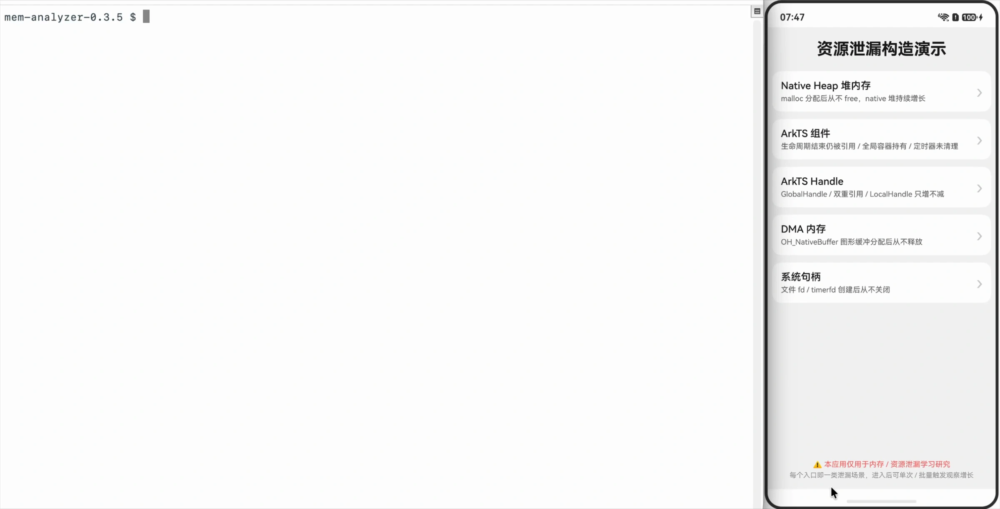
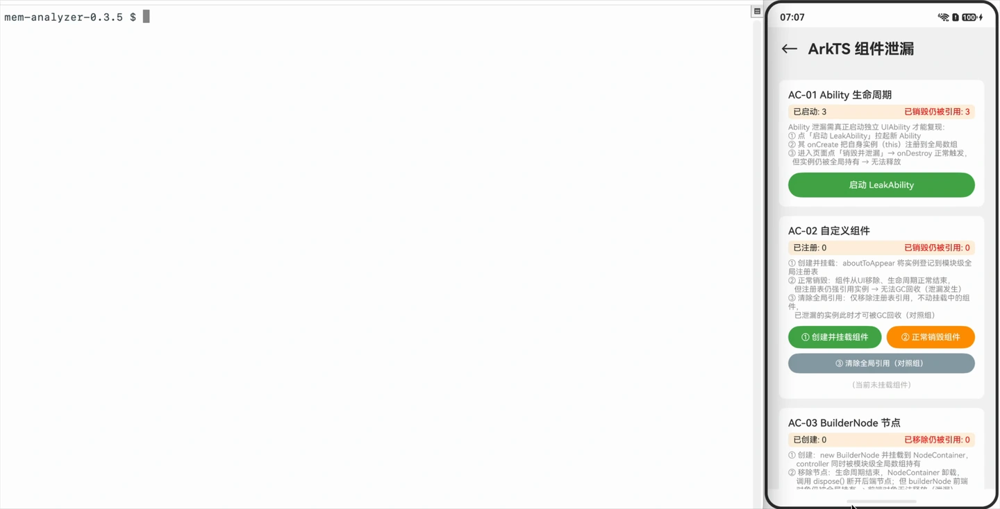
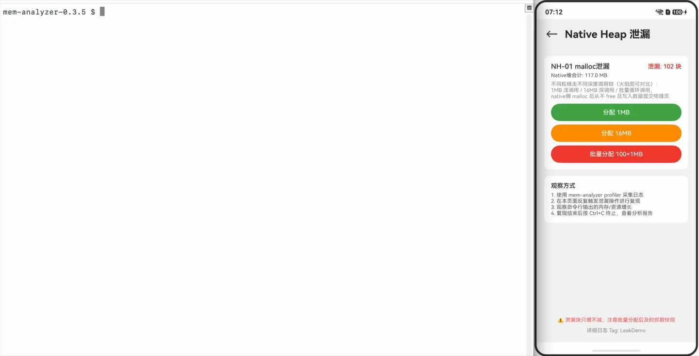
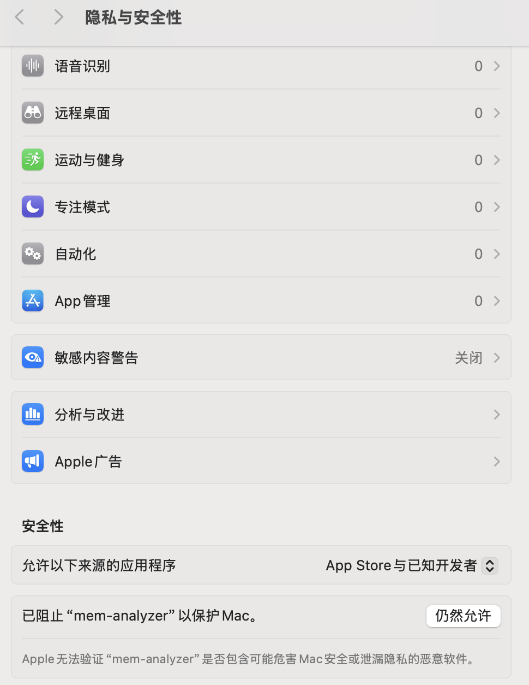

# mem-analyzer 使用手册

资源泄漏日志抓取与分析工具的完整命令行使用说明

## 安装

### Windows

解压 `mem-analyzer-{version}-win64.zip`，通过命令行运行 `mem-analyzer.exe` 。

### macOS

解压 `mem-analyzer-{version}-macos.zip`，参考 [macOS运行mem-analyzer](#macos运行mem-analyzer)。

### Linux

解压 `mem-analyzer-{version}-linux.tar.gz`，通过命令行运行 `mem-analyzer`。

***

## 真机演示

> 以下为真机演示场景，通过视频展示各场景的完整操作流程。

### 场景一：根据ArkTS快照日志分析组件泄漏和TOP引用链

```bash
# 选择 -o 参数，自动生成 HTML 分析报告，并在默认浏览器中打开
mem-analyzer jsleak ~/Downloads/hidumper-jsheap-63074-63074-1787051285526.rawheap -o 
```

#### 支持分析单个堆快照文件，也可同时导入 jsleaklist 文件，进行组件泄漏和 TOP 引用链分析



### 场景二：导出ArkTS快照日志分析组件泄漏和TOP引用链

```bash
# 支持按应用名匹配已安装应用，例如：泄漏演示（包名 com.example.memoryleakapplication）
mem-analyzer profiler 泄漏演示 -c snapshot -o
```

#### 支持直接导出ArkTS快照日志文件并分析组件泄漏和TOP引用链



### 场景三：抓取NativeHeap内存泄漏日志并分析TOP函数与调用链

```bash
# 如果应用未启动，会自动拉起应用并采集 htrace 日志
mem-analyzer profiler 泄漏演示 -c nativeheap -o
```

#### 自动拉起应用并采集 htrace 日志，问题复现后可通过 Ctrl+C 退出采集并自动化分析，结束后自动打开分析报告


### 场景四：抓取ArkTS Handle泄漏日志并分析GlobalHandle与LocalHandle泄漏

```bash
# 采集 local handle 日志时，会自动重启应用并采集
mem-analyzer profiler 泄漏演示 -c handle -o
```

#### 自动重启应用并采集 handle 日志，问题复现后可通过 Ctrl+C 退出采集并自动化分析，结束后自动打开分析报告



***

## 命令总览

```
mem-analyzer [全局选项] [子命令] [子命令选项] <文件...>
```

**采集类**

| 子命令        | 别名     | 用途                                            |
| ---------- | ------ | --------------------------------------------- |
| `profiler` | `prof` | 通过hdc，从连接的设备实时采集ArkTS堆快照 / htrace / ArkTS句柄日志 |

**分析类**

| 子命令        | 别名   | 用途                                           |
| ---------- | ---- | -------------------------------------------- |
| （不指定）      | —    | 根据输入文件类型，自动选择子命令进行分析，并输出分析结果                 |
| `trace`    | `tr` | 分析nativeheap/mmap/dma/ashmem/fd/thread类型的内存维测日志（.htrace） |
| `tshandle` | `th` | 分析 ArkTS 句柄日志（.zip）                          |
| `jsleak`   | `jl` | 分析 ArkTS堆快照（.heapsnapshot/.rawheap）          |

***

## 全局选项

以下选项可用于大部分的子命令：

| 选项                    | 说明                   |
| --------------------- | -------------------- |
| `-d, --out-dir DIR`   | 输出目录，默认 `out`        |
| `-p, --parse-only`    | 仅解析，跳过分析             |
| `-o, --auto-open`     | 处理完成后自动打开结果文件        |
| `-f, --format FORMAT` | 输出格式：`json` 或 `html` |
| `-v, --version`       | 显示版本信息并退出            |
| `-h, --help`          | 显示帮助信息               |
| `--verbose`           | 启用 debug 级日志（打印内部调试信息）    |
| `--keep-temp`         | 保留临时目录（中间产物），不自动清理       |
| `--debug`             | 排障模式，等价于 `--verbose --keep-temp` |

***

## 子命令

### 资源日志采集

#### `profiler` — 资源日志采集

```bash
mem-analyzer profiler <bundle> [选项]
```

> **注意**：`profiler` 不分析本地文件，而是通过 `hdc` 连接 HarmonyOS 设备，实时采集目标进程的内存数据（快照 / htrace / 句柄日志），并按需对采集结果自动生成分析报告。

**运行前置条件**：

- 已安装 HarmonyOS SDK 工具链，且 `hdc` 已加入 `PATH`（可用 `hdc version` 验证）。
- 设备已连接并开启调试（USB 连接；可用 `hdc list targets` 验证）。
- 设备 API 版本满足采集类型要求：`snapshot` 需 ≥ 24，其他需 ≥ 26。
- 采集目标必须是设备上已安装的应用。

**必选选项**：

| 选项         | 说明                                    |
| ---------- | ------------------------------------- |
| `<bundle>` | 目标应用/进程名（包名或应用名匹配），`--list-apps` 时不需要 |

**采集类型**：

| 选项                    | 说明                                                                                                                                                                                   |
| --------------------- | ------------------------------------------------------------------------------------------------------------------------------------------------------------------------------------ |
| `-c, --category TYPE` | 采集类型，默认 `nativeheap`。可选值：`nativeheap`/`nh`/`native`、`snapshot`/`snap`、`globalhandle`/`global`/`gh`、`allhandle`/`handle`/`ah`、`localhandle`/`local`/`lh`、`nativeleaks`/`nl`、`fd`、`dma`、`thread`、`ashmem` |

**可选选项**：

| 选项                  | 说明                             |
| ------------------- | ------------------------------ |
| `-t SECONDS`        | 采集时长（秒），默认 `120`。`snapshot` 类型显式指定该参数时进入持续采集（见下） |
| `--device ID`       | 指定目标设备，取值为设备序列号（serial number）。仅连接 1 台设备时可省略（工具会自动使用该设备）；连接 ≥2 台设备时必填，`hdc list targets` 无法唯一确定目标时（输出含无法识别的行等）同样必填。取值见 `hdc list targets` |
| `-d, --out-dir DIR` | 输出目录，默认 `out`                  |
| `-S, --so-dir DIR`  | native `.so` 符号表目录，离线符号化（除 `snapshot` 外所有采集类型生效） |
| `--sourcemap PATH` | 指定工程 sourceMap 文件或目录（含 `sourceMaps.map`），生成报告前先还原混淆的编译产物路径为源码路径（仅 `snapshot` 类型生效） |
| `--namecache PATH` | 指定工程 nameCache 文件或目录（含 `nameCache.json`），生成报告前先还原混淆的函数/属性名为原始名（仅 `snapshot` 类型生效） |
| `-o, --auto-open`   | 采集完成后自动生成 HTML 分析报告，并在默认浏览器中打开 |
| `--list-apps`       | 列出设备上已安装的应用后退出                 |

> **多设备连接**：同时连接 ≥2 台设备时必须用 `--device` 指定目标设备，否则命令会失败并列出当前可用设备；仅连接 1 台时可省略，工具会自动锁定该设备（后续所有设备命令都针对它，采集途中拔线也不会误操作到新接入的设备）。工具只在**能确定目标**时才自动决定：`hdc list targets` 输出里若混有无法识别的行，即使只解析出 1 台也会报 `cannot determine the target device` 并要求你用 `--device` 指定，不会随意挑一台。无论哪种方式，工具都会在输出首行打印 `Device: <device-id>`，便于区分并行执行的终端。`--device` 的取值请直接使用 `hdc list targets` 的输出，**不要手动加引号**（Windows `cmd.exe` 下单引号不是引用字符，会导致设备匹配失败）；取值前后的空白会被自动忽略；显式传空值（`--device ""`）会被判为参数错误，并列出当前可用设备。

> **注意区分两个 `-t`**：本工具的 `-t SECONDS` 是采集时长；hdc 的 `-t <connect-key>` 由 `--device` 承载（仅连接 1 台设备时工具也会自动按序列号锁定，同样无需手动传），不要手动传给 hdc。

> **`-o` 与反解参数的联动**：`-o` 采集结束后会按采集类型自动派发分析报告——`nativeheap`/`fd`/`dma`/`thread`/`ashmem` 走 `trace`，`nativeleaks` 走 `trace -l`（传入采集到的不可达内存泄漏文件），`globalhandle`/`allhandle`/`localhandle` 走 `tshandle`，`snapshot` 走 `jsleak`。此时 `-S/--so-dir`（native `.so` 反解）会透传给 `trace`/`tshandle` 报告，`--sourcemap`/`--namecache`（ArkTS 反混淆）会透传给 `jsleak` 报告。

> **进程名解析**：`<bundle>` 支持传入包名或应用名匹配。若匹配到多个应用会列出候选并要求提供更精确的名称。可先用 `mem-analyzer profiler --list-apps` 查看设备上的应用列表。

**采集类型详情**：

| 值              | 缩写             | 说明                                        | 对端设备的API等级要求 |
| -------------- | -------------- | ----------------------------------------- | :----------: |
| `snapshot`     | `snap`         | 采集 ArkTS 虚拟机堆内存快照                         |     >=24     |
| `nativeheap`   | `nh`, `native` | 采集 native heap 堆内存分配                      |     >=26     |
| `nativeleaks`  | `nl`           | 采集 native heap 堆内存分配 + 不可达内存泄漏快照         |     >=26     |
| `globalhandle` | `global`, `gh` | 采集ArkTS全局句柄（Global Handle）分配              |     >=26     |
| `localhandle`  | `local`, `lh`  | 采集ArkTS局部句柄（Local Handle）分配               |     >=26     |
| `allhandle`    | `handle`, `ah` | 采集ArkTS局部 & 全局句柄（Local & Global Handle）分配 |     >=26     |
| `fd`           | —              | 采集文件描述符（fd）分配                             |     >=26     |
| `dma`          | —              | 采集 DMA（ion）内存分配                           |     >=26     |
| `thread`       | —              | 采集线程创建/销毁栈                                |     >=26     |
| `ashmem`       | —              | 采集匿名共享内存（ashmem）分配                        |     >=26     |

**采集流程说明**：

- **应用运行状态检测：**
  - 对 `nativeheap`/`nativeleaks`/`global`/`fd`/`dma`/`thread`/`ashmem` 类型，若目标应用未运行，采集前，工具会通过 `aa start` 自动拉起。
  - 对`local` 类型，由于需要应用冷启动才能追踪到局部句柄分配，工具会在就绪后重启目标应用，然后再进行采集。
  - 对`snapshot`类型，需要应用已提前运行，否则无法抓取
- **启动采集：**
  - 工具通过hdc命令，启动htrace/ArkTS snapshot/ArkTS句柄维测抓取。
  - 在采集过程中，轮询采集状态，等待采集结束
  - 采集期间可按 `Ctrl+C`（macOS 为 Control+C）提前停止，工具会正常结束 hiprofiler 会话并保存已采集的数据。
  - 采集期间目标设备掉线（拔线、hdc 断连）时，工具会立即结束轮询、正常结束 hiprofiler 会话并保存已采集的数据，不会空等到 `-t` 超时；已连接的其它设备不受影响。
- **采集完成：**
  - 收集并拉取维测日志到PC上，按需启动分析流程

**使用示例**：

```bash
# 列出设备上已安装的应用
mem-analyzer profiler --list-apps

# 采集 native heap 堆内存（默认类型）分配栈 60 秒
mem-analyzer profiler -t 60 com.example.app 

# 同时连接多台设备时，用 --device 指定目标设备（取值见 hdc list targets，勿手动加引号）
mem-analyzer profiler --device 33Z0224A22021343 -c nativeheap -t 60 com.example.app 
# 采集 ArkTS 虚拟机堆快照（目标应用需已运行，立即导出一次后结束）
mem-analyzer profiler -c snap com.example.app 

# 持续采集 ArkTS 虚拟机堆快照 300 秒：开始/结束各一份，ArkTS heap 连续高于峰值时补采一份
mem-analyzer profiler -c snap -t 300 com.example.app 

# 持续采集快照并生成开始 vs 结束的对比分析 HTML 报告（自动打开）
mem-analyzer profiler -c snap -t 300 -o com.example.app

# 采集ArkTS局部 & 全局句柄分配栈，并自动生成 HTML 报告
mem-analyzer profiler -o -c lh com.example.app 

# 采集 native heap + 不可达内存泄漏快照，自动生成含泄漏过滤的分析报告
mem-analyzer profiler -o -c nl com.example.app 

# 采集文件描述符分配栈
mem-analyzer profiler -c fd com.example.app 

# 采集线程创建/销毁栈
mem-analyzer profiler -c thread com.example.app 

# 采集匿名共享内存分配栈
mem-analyzer profiler -c ashmem com.example.app 
```

**输出结构**：

一次采集对应一个会话目录 `out/<采集类型>-<目标进程>-<时间戳>/`，采集文件与分析报告都放在该目录内：

```
out/<type>-<bundle>-<timestamp>/
├── <采集文件>              # .htrace / .zip / .rawheap（取决于采集类型）
├── smaps_<timestamp>.txt  # smaps日志（nativeheap/global/local/dma/thread/ashmem）
├── fds_<timestamp>.txt    # fd列表日志（fd）
├── <采集文件stem>.html     # 仅当指定 -o 时生成的分析报告
```

**设备目录（device-id）**：只有**显式传了 `--device`** 时，会话目录之上才会再加一层以该设备 device-id（即 `hdc -t` 的取值）命名的目录。设备层跟随你的显式选择——工具替你自动选定设备时**不会**改变 `-d` 目录的形状：

```
# 显式 --device：-d 目录（默认 out）下的第一层是 device-id
out/<device-id>/<type>-<bundle>-<timestamp>/

# 仅连接 1 台设备、未传 --device（工具自动使用该设备）：保持扁平，不加设备层
out/<type>-<bundle>-<timestamp>/
```

序列号里若含 Windows 路径不允许的字符，会被替换为 `_`（由工具内部清洗），目录名仍可对应到设备。

**没有选定设备时也不会有设备层**，分两种情况：0 台设备、`hdc list targets` 报错、hdc 不存在时会**直接报错退出**（在建目录之前，不会留下目录）；`hdc list targets` 里有候选、但同时又出现本工具无法识别的行时，工具**不会替你猜**，而是报 `cannot determine the target device` 并把你无法识别的那几行原文列出来，再列出候选、要求你用 `--device` 显式指定。只有连一个候选都解析不出、输出又无法识别（设备台数都不确定）时才会继续采集，此时会额外打印一行告警（同样附上无法识别的行），产物也按无设备层处理。

只要有设备驱动本次运行——显式传了 `--device`，或者 1 台设备被自动选定——工具就会在**设备解析完成后立刻**打印一行 `Device: <device-id>`（`--list-apps` 与采集两条路径都是这样，且都是输出的第一行），便于同时连接多台设备时区分终端输出；没有选定设备时不打印。这一行是纯诊断信息，与上面说的设备层目录**互不影响**：自动选定设备时仍会打印，但不会因此加目录层。

`-c snapshot` 是否指定 `-t` 直接体现在目录名上：指定 `-t`（持续采集）时目录名多一段 `session`，不指定时就是单次导出（下面的示例都不带设备层目录）。

`-c snapshot -t` 持续采集时，开始、结束各导出一份快照，ArkTS heap 连续 10 个采样点都比已记录的峰值高出 50MB 以上时还会补采峰值快照（峰值基线取首份快照导出后的第一个采样点，且只要触发补采就把峰值刷新为当前值，后续采样都和新峰值比较）。会话只保留一份峰值快照：峰值只会升高（进程重启也不重置），所以保留的那份始终是会话内最大值的那一份。开始快照只在会话开始时导出一次，之后不会被覆盖或删除（进程重启也不会重新导出）。三份快照都平铺在会话目录里，用文件名末尾的 `-start`/`-peak`/`-end` 区分（不再用角色子目录）：

```
out/snapshot-session-<bundle>-<timestamp>/
├── hidumper-jsheap-...-start.rawheap
├── hidumper-jsheap-...-peak.rawheap
└── hidumper-jsheap-...-end.rawheap
```

`snapshot -t` 配合 `-o` 时，不会对每份快照单独生成报告，而是以开始快照为基线、结束快照为目标，调用 `jsleak -b` 生成一份对比分析 HTML 报告（文件名 `<start-stem>-vs-<end-stem>.html`），并在默认浏览器中打开。对比报告复用 jsleak 对比模式的全部能力（对象增量、引用链差异、冰柱图）。

不指定 `-t` 时为单次导出，目录名不含 `session`，只有一份不带角色后缀的快照：

```
out/snapshot-<bundle>-<timestamp>/
└── hidumper-jsheap-....rawheap
```

**输出说明**：

| 采集类型               | 采集产物                                    | <br /> |
| ------------------ | --------------------------------------- | :----- |
| `snapshot`         | `hidumper-jsheap-*` 堆快照                 | <br /> |
| `nativeheap`       | `mem_analyzer_hiprofiler_data_*.htrace` | <br /> |
| `nativeleaks`      | `mem_analyzer_hiprofiler_data_*.htrace` + `memleak-native-orphansnapshot-*.txt` | <br /> |
| `global` / `local` | `hiprofiler_data_*.zip`                 | <br /> |
| `fd`               | `mem_analyzer_hiprofiler_data_*.htrace` | <br /> |
| `dma`              | `mem_analyzer_hiprofiler_data_*.htrace` | <br /> |
| `thread`           | `mem_analyzer_hiprofiler_data_*.htrace` | <br /> |
| `ashmem`           | `mem_analyzer_hiprofiler_data_*.htrace` | <br /> |

> **注意**：`-o` 会调用同目录下的 `mem-analyzer` 二进制对采集结果执行对应分析子命令，并在分析成功后自动打开 HTML 报告。若采集内容为空，则不会生成 HTML。`snapshot -t` 配合 `-o` 时，改为以开始快照为基线、结束快照为目标调用 `jsleak -b` 生成单份对比报告。

***

### 资源日志分析

#### 1. 自动检测模式

不指定子命令时，`mem-analyzer` 会自动检测文件类型并处理。

```bash
mem-analyzer [全局选项] <文件...>
```

```bash
# 自动检测&分析 .htrace 文件的nativeheap信息
mem-analyzer profile.htrace

# 自动检测&分析 .htrace 文件的nativeheap信息，并且自动打开结果文件
mem-analyzer -o profile.htrace

# 自动检测&分析 .heapsnapshot 文件
mem-analyzer snapshot.heapsnapshot

# 自动检测&分析 .zip 文件的ArkTS句柄信息
mem-analyzer handle_data.zip
```

***

#### 2. `jsleak` — ArkTS 堆日志分析

```bash
mem-analyzer jsleak [选项] <输入文件>
```

> **注意**：`jsleak` 根据文件扩展名判断输入类型：`.rawheap` 结尾的文件会先转换为 heapsnapshot 再解析；其他扩展名直接视为 heapsnapshot 处理。

**专属选项**：

| 选项                    | 说明                                                  |
| --------------------- | --------------------------------------------------- |
| `-n, --top-n N`       | 输出 Top N 结果，默认 `50`                                |
| `-l, --leaklist FILE` | 泄漏定义文件（`.jsleaklist`）路径                             |
| `-m, --mode MODE`     | 分析模式：`all`（默认）、`property-tag`/`pt`、`top-chain`/`tc` |
| `-b, --baseline FILE` | 基线快照 A；指定后进入对比模式，位置参数为目标快照 B |
| `--sourcemap PATH` | 指定工程 sourceMap 文件或目录（含 sourceMaps.map），用于将混淆的编译产物路径还原为源码路径 |
| `--namecache PATH`  | 指定工程 nameCache 文件或目录（含 nameCache.json），用于将混淆的函数/属性名还原为原始名 |
| `-o, --auto-open`     | 分析完成后自动打开结果文件                                       |

**输入文件**：`.heapsnapshot` 或 `.rawheap` 文件。

**使用示例**：

```bash
# 分析堆快照
mem-analyzer jsleak snapshot.rawheap

# 分析堆快照，完成后直接打开结果文件
mem-analyzer jsleak -o snapshot.rawheap

# 指定 Top-N 和泄漏定义文件
mem-analyzer jsleak -n 20 -l my_leaks.jsleaklist snapshot.heapsnapshot

# 仅属性标签分析
mem-analyzer jsleak -m pt snapshot.heapsnapshot

# 仅最短引用链分析
mem-analyzer jsleak -m tc snapshot.heapsnapshot

# 反混淆分析：使用工程 sourceMap 与 nameCache 归档目录，将混淆的函数名/属性名与编译产物路径还原为原始名/源码路径后分析
mem-analyzer jsleak --sourcemap <PATH> --namecache <PATH> snapshot.heapsnapshot
```

> **反混淆说明**：指定 `--sourcemap` 或 `--namecache` 时，解析前先在系统临时目录中对快照做还原（将混淆的函数名/属性名与编译产物路径还原为原始名/源码路径与行号）；还原成功则基于还原后的快照内容解析与分析，临时产物随命令结束自动清理，不写入 `--out-dir`（默认 `out`）——`out` 下仅生成最终报告。未指定时行为与之前完全一致。若索引目录不存在，或目录内缺少对应索引文件（如无 `sourceMaps.map` / `nameCache.json`），仅打印告警并继续分析未还原的快照。

**输出结构**：

```
out/<filename>/
└── <filename>.html
```

**输出说明**：

| 输出            | 说明                        |
| ------------- | ------------------------- |
| `<name>.html` | 交互式 HTML 报告，含类层级、保留大小和引用链 |

**对比模式**：

```bash
mem-analyzer jsleak -b <快照A> [选项] <快照B>
```

快照 A（`-b` 的入参）为基线，快照 B（位置参数）为目标。两份文件格式必须一致（`.heapsnapshot` 或 `.rawheap`；`.rawheap` 会先通过 `rawheap_translator` 转换）。对象以快照节点 ID 匹配：两份快照中 ID 相同的存活对象不参与差异统计，仅新增和消失的节点参与聚合；因此新增数与消失数相同时，节点数净变化可能为 0，但仍属于有效差异（记为 `replaced`）。

对比模式专属说明：

| 选项                    | 说明                                                  |
| --------------------- | --------------------------------------------------- |
| `-m, --mode MODE`     | 选择对比输出维度：`all`（默认）输出属性标签对比 + 最短引用链对比；`pt`/`property-tag` 仅输出属性标签对比（ArkUI 组件/ArkTS 泄漏对象）；`tc`/`top-chain` 仅输出最短引用链对比 |
| `-n, --top-n N`       | 每个方向（增长/缩减）输出的 Top N 结果，默认 `50`（与单快照一致）              |
| `-f, --format FORMAT` | 输出格式：仅支持 `html`；不指定或 `-f html` 均只生成 HTML 报告（`json` 暂不支持） |
| `--sourcemap` / `--namecache` / `-o` | 与单快照模式语义一致                                        |
| `-l` / `-f json`      | **不支持**，与 `-b` 同用会报错拒绝                             |

**使用示例**：

```bash
# 对比两份堆快照（生成 HTML 报告，含属性标签与最短引用链两类对比）
mem-analyzer jsleak -b baseline.heapsnapshot target.heapsnapshot

# 仅输出属性标签维度的对比（ArkUI组件/ArkTS泄漏对象）
mem-analyzer jsleak -b baseline.heapsnapshot -m pt target.heapsnapshot

# 仅输出最短引用链维度的对比
mem-analyzer jsleak -b baseline.heapsnapshot -m tc target.heapsnapshot

# 指定每个方向的 Top N
mem-analyzer jsleak -b baseline.rawheap -n 20 target.rawheap
```

**输出结构**：

```
out/<快照B名称>/
└── <快照A名称>-vs-<快照B名称>.html
```

**输出说明**：

- `<快照A名称>-vs-<快照B名称>.html`：包含“ArkUI组件/ArkTS对象泄漏分析报告”和“快照最短引用链分析报告”。增长使用快照 B 的引用链，缩减使用快照 A 的引用链。

***

#### 3. `tshandle` — ArkTS 句柄日志分析

```bash
mem-analyzer tshandle [选项] <文件...>
```

> **注意**：`tshandle` 子命令忽略文件扩展名，默认将输入内容视为 ZIP 格式进行处理。

**专属选项**：

| 选项                  | 说明                   |
| ------------------- | -------------------- |
| `-d, --out-dir DIR` | 输出目录，默认 `out`        |
| `-p, --parse-only`  | 仅解析，跳过分析             |
| `-f, --format FMT`  | 输出格式：`json` 或 `html` |
| `-S, --so-dir DIR`  | native `.so` 符号表目录，用于 htrace 离线符号化，缺省不反解 |
| `--sourcemap PATH`  | sourceMap 文件或目录，用于还原 ArkTS 混淆路径/行号（缺省不还原） |
| `--namecache PATH`  | nameCache 文件或目录，用于还原 ArkTS 混淆名称（缺省不还原） |
| `-o, --auto-open`   | 分析完成后自动打开结果文件        |

**输入文件**： `.zip` 文件，通常包含：

- `*.htrace` — 内存分配栈数据（必需，否则报错退出）
- `*.rawheap` — 原始堆快照（可选，缺失时跳过 ArkTS 类分析）
- `*.binpb/*.txt` — 地址映射文件（可选，缺失时跳过 ArkTS 类分析）

**使用示例**：

```bash
# 生成完整分析 HTML 报告
mem-analyzer tshandle handle_data.zip

# 分析并输出 JSON（含 Top 对象、调用链、下游调用树）
mem-analyzer tshandle -f json handle_data.zip

# 解析句柄数据为 JSON（含调用栈和 ArkTS 类分析）
mem-analyzer tshandle --parse-only -f json handle_data.zip
```

**输出结构**：

```
out/<filename>/
└── <filename>.html          # 或 .json
```

**输出说明**：

| 模式             | 格式     | 输出内容                            |
| -------------- | ------ | ------------------------------- |
| 分析模式           | `html` | 交互式 HTML 报告，含句柄类型分析、类表格、调用图     |
| 分析模式           | `json` | 分析结果（Top 对象、调用链、下游调用树、trace 元数据） |
| `--parse-only` | `json` | 调用栈、ArkTS 类实例、nativeRef 条目、内存摘要 |

***

#### 4. `trace` — htrace日志分析

```bash
mem-analyzer trace [选项] <文件...>
```

> **注意**：`trace` 子命令忽略文件扩展名，默认将输入内容视为 htrace 格式进行处理。

**专属选项**：

| 选项                   | 说明                                                             |
| -------------------- | -------------------------------------------------------------- |
| `-c, --category CAT` | 资源类别：`nativeheap`（默认）、`mmap`、`dma`、`ashmem`、`fd`、`thread` |
| `-s, --scope SCOPE`  | 分析范围：`app-only`、`system-only`、`app-and-system`（默认）、`mixed`     |
| `-n, --top-n N`      | 报告中显示 Top N 符号，默认 `10`                                         |
| `-S, --so-dir DIR`   | native `.so` 符号表目录，用于离线符号化，缺省不反解 |
| `-o, --auto-open`    | 分析完成后自动打开结果文件                                                  |
| `-l, --leaklist FILE` | Native Leaks 不可达内存泄漏文件（magic `NSNAP1.0` + count + 16B 块），L1 地址命中过滤；分析模式（不带 `-p`）额外做 L2（含 `__emutls_get_address` 帧排除）+ L3（沙箱目录 `data/storage/el` 且 `.so` 分应用/系统栈，`libarkweb_engine.so` 例外归系统），top N 之外的栈合并为 other 火焰图 |

**`-s, --scope`** **详细说明**：

控制 Top 符号列表中包含哪些层级的符号，用于聚焦特定层级的泄漏分析：

| 值                | 说明                                    | 适用场景           |
| ---------------- | ------------------------------------- | -------------- |
| `app-only`       | 仅显示应用层符号（如 `libentry.so`、`libace.so`） | 排查应用自身的内存泄漏    |
| `system-only`    | 仅显示系统层符号（如 `libc.so`、`libskia.so`）    | 排查系统库或框架层泄漏    |
| `app-and-system` | 同时显示应用层和系统层符号（**默认**）                 | 全面分析，不区分层级     |
| `mixed`          | 显示跨层混合符号（调用链同时涉及应用和系统层）               | 排查应用与系统交互导致的泄漏 |

> **注意**：`-s` 仅在分析模式（非 `--parse-only`）下生效。`--parse-only` 模式会输出全部资源类型的调用栈，不受 scope 影响。
>
> **`-l` 泄漏过滤输出**：`trace -l -p`（解析模式）仅做 L1 地址匹配过滤，输出单 `callStacks`（与普通 `-p` 一致）；`trace -l`（分析模式，不带 `-p`）做 L1+L2+L3（地址→emutls 排除→沙箱分类），按 `-s` scope 输出 `topSymbols`（app/system/mixed），每组 top N 之外的栈合并为 other 火焰图。

**资源类别说明**：

| 值            | 说明                           |
| ------------ | ---------------------------- |
| `nativeheap` | nativeheap堆内存分配（malloc/free） |
| `mmap`       | mmap 内存映射（匿名映射 + 文件映射）    |
| `dma`        | DMA/ION 内存分配                 |
| `ashmem`     | 匿名共享内存                       |
| `fd`         | 文件描述符分配                      |
| `thread`     | 线程创建/销毁                      |

> **`mmap` 双轨说明**：`mmap` 类别会把结果拆成两个子维度——`mmap-anon（匿名映射）`按符号分析（与 `nativeheap` 类似），`mmap-filepage（文件映射）`按文件聚合分析（输出 Top 文件）。

**使用示例**：

```bash
# 分析nativeheap堆，默认生成 HTML 交互报告
mem-analyzer trace -c nativeheap profile.htrace

# 分析 mmap 内存映射（匿名映射 + 文件映射）
mem-analyzer trace -c mmap profile.htrace

# 分析 DMA 内存，显示 Top 20 符号
mem-analyzer trace -c dma -n 20 dma_profile.htrace

# 分析文件描述符
mem-analyzer trace -c fd -f html fd_profile.htrace

# 仅分析应用层分配
mem-analyzer trace -c nativeheap -s app-only profile.htrace

# 仅解析，提取所有调用栈到 JSON
mem-analyzer trace -p profile.htrace

# 按 Native Leaks 不可达内存泄漏文件过滤；-p 走解析输出 callStacks，不带 -p 走分析输出 topSymbols（app/system/mixed 含 other）
mem-analyzer trace -l leaks.bin -f json profile.htrace
```

**输出结构**：

```
out/<filename>/
├── <filename>.json     # 或 <filename>.html
```

**输出说明**：

| 模式             | 格式     | 输出内容                       |
| -------------- | ------ | -------------------------- |
| `--parse-only` | `json` | 所有调用栈（含解析后的符号、库名、build ID） |
| 分析模式           | `json` | 统计摘要、Top 符号、火焰图数据          |
| 分析模式           | `html` | 交互式 HTML 报告，含火焰图、冰柱图和调用栈表格 |

> **注意**：`--parse-only` 模式下 `-c` 参数不影响输出（会输出全部资源类型的调用栈）。

***

## 支持的文件类型

| 扩展名             | 对应子命令      | 说明                        |
| --------------- | ---------- | ------------------------- |
| `.htrace`       | `trace`    | Hiprofiler 原生内存追踪         |
| `.zip`          | `tshandle` | ArkTS 句柄日志包（htrace + 堆快照） |
| `.heapsnapshot` | `jsleak`   | ArkTS 堆快照                 |
| `.rawheap`      | `jsleak`   | 原始堆数据（自动转换为 heapsnapshot） |

***

## 输出目录结构

指定 `-d out` 后，输出文件会嵌套在 `out/<输入文件名>/` 下，文件名与输入文件相同（仅扩展名变化）。

**示例**：假设有三个输入文件 `native.htrace`、`handle_data.zip`、`snapshot.heapsnapshot`，输出结构如下：

```
out/
├── native/                   # 目录名 = 输入文件名
│   ├── native.html           # 输出文件名 = 输入文件名 + .html
│   └── native.json           # 或 .json
├── handle_data/
│   └── handle_data.html
├── snapshot/
│   └── snapshot.html
└── target/
    └── baseline-vs-target.html
```

**说明**：`native`、`handle_data`、`snapshot` 仅为示例，实际目录名取决于输入文件名称。

***

## 查看版本

```bash
mem-analyzer --version
# mem-analyzer version 0.2.5
```

***

## 常用场景

### 场景一：ArkTS堆快照分析

```bash
# 1. 分析并生成html报告
mem-analyzer app.rawheap

# 2. 分析并生成html报告，显示 Top 20 符号
mem-analyzer jsleak -n 20 snapshot.heapsnapshot

# 3. 分析并生成html报告，并自动打开结果文件
mem-analyzer jsleak -o snapshot.heapsnapshot
```

### 场景二：ArkTS 句柄日志分析

```bash
# 1. 分析 zip 包，分析并生成html报告
mem-analyzer handle_data.zip

# 2. 分析并生成html报告，显示 Top 20 符号
mem-analyzer tshandle -n 20 handle_data.zip

# 3. 分析并生成html报告，并自动打开结果文件
mem-analyzer -o handle_data.zip
```

### 场景三：htrace日志文件分析

```bash
# 1. 分析nativeheap, 生成html报告
mem-analyzer leak.htrace

# 2. 分析dma, 生成html报告
mem-analyzer trace -c dma -f html leak.htrace

# 3. 分析nativeheap，且仅显示应用层的Top符号
mem-analyzer trace -s app-only leak.txt

# 4. 分析并生成html报告，并自动打开结果文件
mem-analyzer -o leak.htrace
```

### 场景四：提取htrace调用栈数据进行二次分析

```bash
# 输出 JSON 格式的原始调用栈数据
mem-analyzer -p data.htrace

# 后处理 out/data/data.json
```

### 场景五：资源日志采集并一键分析

```bash
# 1. 确认设备已连接（同时连接 ≥2 台时，后续采集命令需加 --device <serial number>）
hdc list targets

# 2. 采集目标应用60S的nativeheap堆分配，生成分析报告，并自动打开
mem-analyzer profiler -c nh -t 60 -o com.example.app

# 3. 采集目标应用的堆快照，生成分析报告，并自动打开
mem-analyzer profiler -c snapshot -o com.example.app
```

***

## macOS运行mem-analyzer

受限于权限管理，在macOS上运行，需授权运行mem-analyzer，或者自行编译运行。

### 方式1：移除隔离属性
1. 下载发布的[mem-analyzer二进制文件](https://gitcode.com/openharmony/developtools_profiler/tree/master/tools/mem_analyzer/releases)
2. 解压二进制文件到任意目录，例如 `~/Documents/mem-analyzer/`
3. 打开“终端”，切换到解压目录，移除隔离属性
```bash 
cd ~/Documents/mem-analyzer/
# 递归移除隔离属性，包括子目录中的文件
xattr -rd com.apple.quarantine ./
```

### 方式2：授权运行mem-analyzer

1. 下载发布的[mem-analyzer二进制文件](https://gitcode.com/openharmony/developtools_profiler/tree/master/tools/mem_analyzer/releases)
2. 解压二进制文件到任意目录，例如 `~/Documents/mem-analyzer/`
3. 打开“终端”，切换到解压目录，运行mem-analyzer
```bash 
cd ~/Documents/mem-analyzer/
./mem-analyzer
```

4. 首次运行时，会弹出如下提示，点击右上的<b>问号</b>，进入手册页面
   
   
5. 进入手册页面后，可以看到   <b>“为我打开“隐私与安全性”设置”</b> , 点击此链接，前往系统设置中的“隐私与安全性”设置页面。
   
   
6. 在系统隐私与安全性设置中的“安全性”设置页面下，可看到  <b>已阻止“mem-analyzer”以保护Mac</b>，点击后面的<b>“仍然允许”</b>。
   
   
7. 回到终端，重新运行mem-analyzer，会弹出如下提示，选择<b>“仍要打开”</b>
   
   
8. 弹出如下提示，授权通过后，即可运行
   
   
9. 由于mem-analyzer在运行时，会调用<b>trace\_streamer\_mac</b>和<b>rawheap\_translator</b>，因此同样需要用户进行上诉的授权流程。

<br />

<b>注意：针对单个二进制的授权是永久的；但每次重新下载后，运行新下载的二进制都需要重新授权。</b>

### 方式3：自行编译运行mem-analyzer，无需授权

1. 下载代码到本地目录，例如 `~/Documents/mem-analyzer/`
2. 进入代码目录，例如 `~/Documents/mem-analyzer/cpp`
3. 使用脚本编译代码，并手动运行mem-analyzer
```bash
# 编译代码，编译脚本会校验环境，提示用户下载依赖项
./release-mac.sh
# 编译完成后，在cpp目录下有`mem-analyzer-x.x.x-macos-xx`目录，进入该目录，运行mem-analyzer
cd mem-analyzer-x.x.x-macos-xx/
./mem-analyzer
```
***

## 相关文档

| 文档                                                                                                    | 内容                        |
| ----------------------------------------------------------------------------------------------------- | ------------------------- |
| [README.md](https://gitcode.com/openharmony/developtools_profiler/tree/master/tools/mem_analyzer/blob/master/README.md)         | 项目概述、架构说明、构建指南。(注意版本对应关系) |
| [cpp/README.md](https://gitcode.com/openharmony/developtools_profiler/tree/master/tools/mem_analyzer/blob/master/cpp/README.md) | C++ 引擎详细文档。(注意版本对应关系)     |
